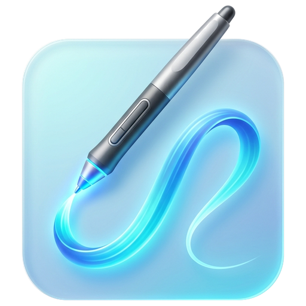

# InkStudio 🖋️🎥

  

  <b>Modern MPP 2.0 Digital Inking, Annotation & Integrated Lecture Recording Studio</b> 
  Built with .NET 9, WPF, and Windows Graphics Capture (WGC).

  
  
  
  
  

---

## ✨ Key Features

### 🖊️ Hardware-Accelerated MPP 2.0 Stylus & Ink Canvas
- **4096 Levels of Hardware Pressure:** Natural stroke dynamics with real-time pressure sensitivity.
- **Hardware Tilt Detection:** Dynamic shading with tilt angle (TiltX and TiltY).
- **Hardware Palm Rejection:** Rest your hand freely on the touchscreen while writing with an active stylus.
- **Hardware Button Support:**
  - Inverted stylus top automatically switches to an eraser.
  - Barrel/side button initiates lasso selection.
- **5 Drawing Instruments:** Pen, Pencil, Highlighter, Eraser (Stroke & Point), and Lasso Selection.
- **25 Color Swatches & Precision Thickness:** Quick picker and `-` / `+` thickness adjustments.

### 🎥 Integrated Lecture Recording Studio
- **Zero-Black-Bars Document Recording:** The screen capture dynamically hugs the visible document bounds, ensuring 100% of the video canvas is clean document content without letterboxing.
- **Multi-Aspect Ratio & Resolution:**
  - `📄 Fit to Document` (Zero Blank Margin)
  - `📺 16:9 Full HD (1080p)` & `HD (720p)`
  - `🖥️ 4:3 Classic Presentation`
  - `📱 9:16 Vertical Video` (Reels, TikTok, Shorts)
  - `⏹️ 1:1 Square Video`
- **Picture-in-Picture (PiP) Webcam:**
  - 4 Corner Snap Zones (Top-Left, Top-Right, Bottom-Left, Bottom-Right).
  - Custom size presets (15%, 22%, 30%, 40%) and slider.
  - Camera Aspect Options: 16:9, 4:3, 1:1, 9:16, or custom ratio.
  - Horizontal Flip / Mirror mode for natural camera interaction.
- **Live Video Composition Preview:** Real-time mini preview displaying both slide content and webcam placement as they will appear in the output MP4 file.
- **Live Audio Meter:** Real-time microphone input volume indicator with peak monitoring.
- **Hardware H.264 Encoder:** Smooth 30fps and 60fps recording output direct to MP4.

### 📄 Document & Presentation Annotations
- **PDF & PowerPoint (PPTX / PPT) Ingestion:** High-resolution page scanning and rendering.
- **Vector Merged PDF Export:** Saves ink annotations directly into vector PDF documents without quality loss.
- **Multi-Page Management:** Sidebar thumbnails, page jumping, add/remove pages.

### 🌐 Multilingual (100% Localized)
Fully dynamic language switcher with zero app restarts required:
- 🇬🇧 **English** (Default)
- 🇹🇷 **Türkçe**
- 🇩🇪 **Deutsch**
- 🇷🇺 **Русский**
- 🇨🇳 **中文**

### 🖐️ Multi-Touch & Navigation
- Smooth two-finger pinch-to-zoom and pan navigation.
- Dedicated 'Touch Inking' toggle for touchscreen-only devices.

---

## 🚀 Download & Run

You can download the latest pre-compiled binary directly from [Releases](https://github.com/EmirCakir7/InkStudio/releases):
1. Download **`InkStudio-v1.0.0-windows-x64.zip`**.
2. Extract the archive.
3. Double-click **`InkStudio.exe`**.

---

## 🙏 Acknowledgements & Attributions

InkStudio is built with the help of these incredible open-source projects and libraries:

| Library | Purpose | License |
| :--- | :--- | :--- |
| [**WPF-UI**](https://github.com/lepoco/wpfui) | Modern Windows 11 Fluent Design System styling, controls, and animations. | MIT |
| [**ScreenRecorderLib**](https://github.com/slinch/ScreenRecorderLib) | High-performance .NET screen, window, and audio recording powered by Windows Media Foundation. | MIT |
| [**FlashCap**](https://github.com/kekyo/FlashCap) | High-speed, lightweight webcam capture library for DirectShow and MediaFoundation. | Apache-2.0 |
| [**Docnet.Core**](https://github.com/GowenGit/docnet) | Fast, cross-platform PDF rendering engine powered by Google PDFium. | MIT |
| [**DocumentFormat.OpenXml**](https://github.com/dotnet/Open-XML-SDK) | Official Microsoft SDK for parsing and extracting slides from PowerPoint (.pptx) presentations. | MIT |
| [**PDFsharp**](https://github.com/empira/PDFsharp) | Vector-level PDF creation, page manipulation, and high-fidelity merged document exports. | MIT |

---

## 📄 License
This project is licensed under the [MIT License](LICENSE).

